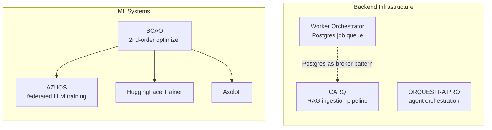

<div align="center">


<br/><br/>

[**About**](#about) &nbsp;·&nbsp; [**Featured Work**](#featured-work) &nbsp;·&nbsp; [**Ecosystem**](#ecosystem) &nbsp;·&nbsp; [**Tech Stack**](#tech-stack) &nbsp;·&nbsp; [**Contact**](#contact)

<br/>


</div>

<br/>

## About

I'm a software engineer who works where **machine learning meets systems engineering**. I like problems where the abstraction leaks: a 2nd-order optimizer that doesn't fit in VRAM, a job queue that has to survive a worker crash mid-flight, an agent pipeline that must be observable and deterministic in production.

My approach is simple: understand the system from the ground up, measure everything, and ship code that other people can maintain.

<table>
<tr>
<td width="50%" valign="top">

**What I build**
- Optimization & training infrastructure for LLMs
- Decentralized / federated AI training protocols
- Fault-tolerant job queues and RAG pipelines
- Multi-agent orchestration platforms
- Observable, production-grade backends

</td>
<td width="50%" valign="top">

**How I work**
- Benchmarks and ablations before claims
- Explicit failure modes: retries, leases, DLQs
- Fewer moving parts (Postgres before a new broker)
- ADRs for every non-obvious trade-off
- Security and observability as defaults

</td>
</tr>
</table>

<br/>

## Featured Work

### SCAO — Sparse Curvature-Aware Adaptive Optimizer

> **A second-order PyTorch optimizer with near-AdamW memory and throughput cost.** Drop-in replacement for `AdamW`, published on PyPI and archived on Zenodo.

[](https://pypi.org/project/scao/)
[](https://github.com/whispering3/scao/blob/main/LICENSE)
[](https://doi.org/10.5281/zenodo.19870556)
[](https://pypi.org/project/scao/)
[](https://github.com/whispering3/scao)

Full Shampoo-style preconditioning is out of reach on consumer hardware: at transformer widths around 4096, its curvature matrices exceed 128 GB per model copy. SCAO keeps the useful part of the curvature and drops the rest.

| Innovation | What it does |
|---|---|
| **Adaptive rank selection** | Keeps only the top-*k* eigenvectors holding ≥ 95% of spectral mass, cutting memory from `O(m²+n²)` to `O((m+n)·k)` |
| **Sparse block-diagonal FIM** | Bounds eigendecomposition cost on very wide layers without discarding inter-parameter correlation |
| **Phase-transition stability** | EMA bias correction, 50-step blend ramp and adaptive Tikhonov regularization for the Adam → SCAO handoff |
| **Int8 EMA quantization** | Curvature accumulators stored in int8 for a 4× memory saving, with eigendecomposition still in float32 |
| **Fused CUDA / Triton kernels** | Tiled GEMM and fused Kronecker preconditioner with automatic pure-PyTorch fallback |

**Results**

| Benchmark | Outcome |
|---|---|
| Qwen2.5-3B QLoRA on a single 16 GB T4 | **7.14 GB VRAM, stable run**, while full Shampoo failed at step 1 |
| WikiText-2 (500 steps) | **+54% throughput**, validation PPL within 1.5% of AdamW |
| Time-to-quality (PPL ≤ 14.10) | **1.82× faster** wall-clock than AdamW |
| Scaling trend (5M / 10M params) | **−9.6% / −4.8% PPL** vs AdamW |

**Ecosystem:** HuggingFace `Trainer` integration · Axolotl integration ([PR #3624](https://github.com/axolotl-ai-cloud/axolotl/pull/3624)) · scale presets from `scao_sub1b()` to `scao_125b()` · 66 automated tests · full ablation study.

```python
from scao import scao_3b

optimizer = scao_3b(model, lr=2e-4)   # one-line swap for AdamW
```

<br/>

### AZUOS — Decentralized Federated LLM Training

> **Fine-tune large language models collectively, on consumer GPUs, without a centralized cloud.**

Peers join a P2P network and contribute gradients. SCAO is the optimization core, which reduces how often nodes need to synchronize.

- **P2P layer:** Rust daemon on `libp2p` for peer discovery and GossipSub gradient propagation
- **Privacy & robustness:** Rényi differential privacy (DP-SGD) and Krum aggregation against Byzantine peers
- **Onboarding:** Tauri v2 desktop app for miners

`Python` · `PyTorch` · `Rust (libp2p)` · `Tauri` · `TypeScript` &nbsp;|&nbsp; *Private repository, available for review on request*

<br/>

### Worker Orchestrator — PostgreSQL as the Only Broker

> **A low-latency job queue that needs nothing but PostgreSQL 16.** No Redis, no RabbitMQ, no extra failure domain.

[](https://github.com/whispering3/worker-orchestrator)

<table>
<tr>
<td width="55%" valign="top">

- **Transactional enqueue:** a job exists only if the business data was committed
- **Zero-collision concurrency** with `FOR UPDATE SKIP LOCKED`
- **Sub-millisecond reactivity** through `LISTEN/NOTIFY`
- **Lease expiry:** a crashed worker's job is reclaimed automatically
- **Exponential backoff with ±20% jitter** to prevent retry storms
- **Dead letter queue** preserving `payload` and `last_error`
- React dashboard and ADRs documenting each trade-off

</td>
<td width="45%" valign="top">

| Metric | Result |
|---|---|
| Fetch latency | **< 3 ms** |
| Throughput | **> 1,200 jobs/s** on a single RDS instance |
| Concurrency | **50+ workers**, zero deadlocks |

</td>
</tr>
</table>

`Python` · `FastAPI` · `PostgreSQL 16` · `React` · `Docker`

<br/>

### CARQ — Context-Aware RAG Processing Queue

> **A resilient ingestion and semantic-search pipeline for RAG**, built around rate limits, partial failures and resource contention.

[](https://github.com/whispering3/CARQ)

- **10,000+ chunks/min** with graceful degradation
- **Surgical recovery:** only failed chunks are retried, never whole documents
- **Adaptive rate limiting**, circuit breaker and dead letter queue for provider limits
- **Idempotent ingestion** through content-hash deduplication
- **ACID durability** on PostgreSQL + `pgvector`, with multi-instance worker coordination
- **Observability:** structured JSON logs, Prometheus metrics, correlation IDs; Docker and Kubernetes manifests included

`Python` · `FastAPI` · `asyncio` · `PostgreSQL + pgvector` · `SQLAlchemy 2.0` · `Docker` · `Kubernetes`

<br/>

### ORQUESTRA PRO — AI Orchestration Platform

> **Multi-agent pipelines with deterministic execution, live streaming and production observability.**

[](https://github.com/whispering3/Orquestrador-AI)

- **XState state machines** for explicit transitions and controlled error handling instead of unpredictable agent loops
- **API fully decoupled from workers**, so load on one never destabilizes the other
- **Real-time mission streaming** over SSE (`task.*` and `step.*` events)
- **Telemetry** with Prometheus and Grafana: worker health, queue depth, cost and latency
- **BullMQ + Redis** for distributed execution, **Prisma + PostgreSQL** for state persistence

`TypeScript` · `Fastify` · `BullMQ` · `Redis` · `PostgreSQL` · `XState` · `Prometheus` · `Grafana` · `React`

<br/>

## Ecosystem

Two tracks that inform each other: **ML systems** (making advanced training practical on modest hardware) and **backend infrastructure** (making AI workloads reliable in production).



<br/>

## Tech Stack

<div align="center">


<br/>


</div>

| Area | Tools |
|---|---|
| **Languages** | Python · TypeScript · Rust · Go · CUDA / Triton |
| **ML** | PyTorch · LLM fine-tuning (LoRA / QLoRA) · optimization · differential privacy |
| **Backend** | FastAPI · Fastify · NestJS · Node.js · asyncio |
| **Queues & orchestration** | PostgreSQL (`SKIP LOCKED`, `LISTEN/NOTIFY`) · BullMQ · XState |
| **Data** | PostgreSQL · pgvector · Redis · MongoDB · Prisma · SQLAlchemy |
| **Infra & observability** | Docker · Kubernetes · Prometheus · Grafana · GitHub Actions |

<br/>

## Open Source & Writing

- **[`scao`](https://pypi.org/project/scao/)** — published on PyPI with a citable DOI and an integration PR open in [Axolotl](https://github.com/axolotl-ai-cloud/axolotl/pull/3624)
- **[InstructLab proposal](https://github.com/instructlab/training/issues/703)** — adding SCAO as an optimizer option for constrained-hardware training
- **[TabNews write-up](https://www.tabnews.com.br/danilosoz/como-ganhei-convergencia-de-2-ordem-de-graca-no-fine-tuning-de-llms-apresentando-o-scao)** — how SCAO gets second-order convergence "for free" during QLoRA fine-tuning (in Portuguese)

<br/>

## GitHub Activity

<div align="center">

[](https://git.io/streak-stats)

</div>

<br/>

## Contact

I'm open to **full-time roles, contract work and technical collaborations**, especially in AI infrastructure, distributed systems and backend architecture.

<div align="center">

[](https://linkedin.com/in/danilosoz)
&nbsp;
[](mailto:drsouza14@gmail.com)

<br/>


</div>
